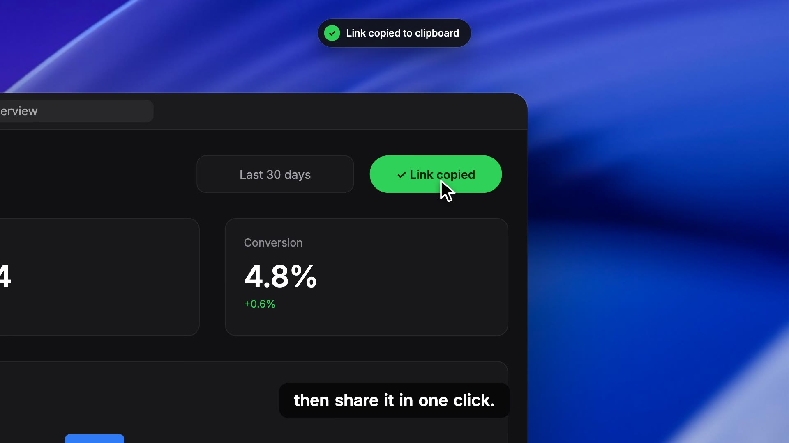

# AutoZoom demo skill

Turn any feature in your codebase into a polished, AutoZoom-style demo video, from one prompt.

```
› make a demo video of our analytics dashboard
```

[](media/promo.mp4)

▶ [Watch the 25-second promo](media/promo.mp4) (made with this skill)

## What it does

A skill for AI coding agents (Claude Code and others that support `SKILL.md` skills). Run inside your project, the agent:

1. **Reads your code:** the page or dashboard, its components, colours, fonts and sample data.
2. **Rebuilds the screen in [Remotion](https://www.remotion.dev):** it imports your React components directly, or ports the UI from any stack (Svelte, Vue and others). Text types into real inputs, rows slide in, buttons change state.
3. **Films it the AutoZoom way:** a macOS window on a wallpaper desktop, a smooth **auto-zoom** camera that follows each action, a real-feeling cursor with clicks, keycaps, word-by-word captions, toasts and spotlights.
4. **Renders an MP4:** frame-perfect, 1920 × 1200 by default.

Your product keeps its own look. Everything around it (the window, camera, cursor and overlays) is AutoZoom's.

## Install

```bash
git clone https://github.com/6space7/autozoom-demo-skill ~/.claude/skills/autozoom-demo-scenes
```

For a single project, clone it into `.claude/skills/autozoom-demo-scenes` inside that project instead.

Requirements: Node 18+. The skill installs Remotion and React into a `demo/` folder in your project the first time it runs.

## Use

Open your project with your agent and ask:

- "Make a demo video of the billing page"
- "Show how search works, AutoZoom style"
- "Create a 10-second launch video for the new onboarding"

Or call the skill directly with `/autozoom-demo-scenes`.

The agent writes everything into `demo/`. To preview and render yourself:

```bash
cd demo
npm run studio    # live preview
npm run render    # → out/demo.mp4
```

## How it's built

| Path | What's there |
|---|---|
| `SKILL.md` | Instructions the agent follows |
| `references/story-api.md` | The story format: camera, cursor, clicks, captions, toasts, spotlights; screen hooks; using your own components, Tailwind and fonts |
| `references/style.md` | The AutoZoom look and motion rules |
| `scripts/setup.mjs` | Creates and installs the `demo/` Remotion project |
| `assets/remotion-template/` | Camera, window, cursor, overlays, an example screen and story |

Each video is one data file (`src/story.tsx`) plus the screen component(s) built from your code. A short example:

```tsx
camera: [
  { at: 0,   zoom: 1 },
  { at: 130, zoom: 1.8, focus: SEARCH },  // auto-zoom onto the search box
  { at: 270, zoom: 1.8, focus: SEARCH },
  { at: 330, zoom: 1 },
],
cursor: [{ at: 0, x: 720, y: 720 }, { at: 55, x: 488, y: 62 }],
clicks: [58],
captions: [{ from: 140, to: 268, text: 'Search any metric,' }],
```

## License

[MIT](LICENSE)
